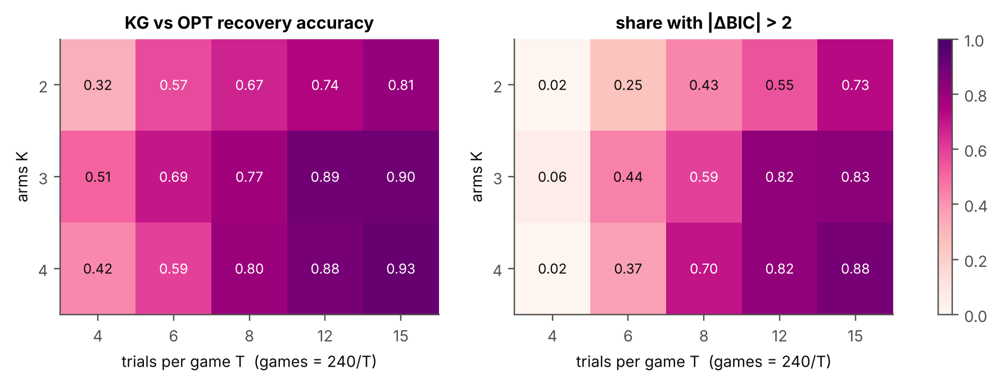

# tinybamdp

**Exact, tabular Bayes-adaptive (BAMDP) and POMDP models of decision-making under uncertainty, written from scratch, with tools to simulate, fit and validate them as cognitive models.**

[](https://colab.research.google.com/github/bunytwirls/tinybamdp-library/blob/main/tinybamdp_tutorial.ipynb)
&nbsp;tutorial &nbsp;&nbsp;
[](https://colab.research.google.com/github/bunytwirls/tinybamdp-library/blob/main/kg_vs_optimal_identifiability.ipynb)
&nbsp;identifiability study

Author: Maimuna Chowdhury · License: MIT · Version: 0



## What the project contains

* **`tinybamdp`**, a library (NumPy and SciPy only) with
  * Beta, Dirichlet and discrete (Bayes-filter) belief states;
  * an exact Bayes-optimal solver for K-armed Bernoulli bandits (backward induction on the Bellman equation; Bellman, 1957), and a
    generic tabular BAMDP solver for unknown transitions (Duff, 2002);
  * discrete POMDPs solved by point-based value iteration (Pineau et al., 2003), with the tiger problem (Kaelbling et al., 1998)
    built in;
  * five cognitive models of bandit choice that share one interface for simulation and likelihood: a delta-rule learner (RW;
    Rescorla & Wagner, 1972), win-stay/lose-shift (WSLS; Robbins, 1952), Knowledge Gradient (KG; Frazier et al., 2008; Ryzhov et
    al., 2012), KG on a forgetful Dynamic Belief Model (KG-DBM; Yu & Cohen, 2009; Zhang & Yu, 2013), and the exact Bayes-optimal
    policy (OPT);
  * maximum-likelihood fitting, leave-one-game-out cross-validation, and tie-aware parameter and model recovery, following the
    workflow of Wilson and Collins (2019).
* **`study`**, an identifiability study built on the library (needs Matplotlib), with its results in `tinybamdp/results/` and `tinybamdp/figures/`.
* **Two notebooks**: `tinybamdp_tutorial.ipynb` (how to use the library) and `kg_vs_optimal_identifiability.ipynb` (the study),
  at the top level of the repository and in `tinybamdp/notebook/`.

**Full API reference: [`API.md`](API.md)** lists every module, class and function with its parameters, defaults and return values.

## Research question

Zhang and Yu (2013) reported that human bandit choices are better described by a *myopic* Knowledge-Gradient (KG) policy than by
the Bayes-optimal policy (OPT). **Which task designs can tell these two models apart, and which of their parameters can be
identified?**

Related work includes Bayesian models of human bandit choices (Acuna & Schrater, 2010; Steyvers et al., 2009), the horizon task
(Wilson et al., 2014), known weaknesses of the KG policy on bandits (Edwards et al., 2017), and adaptive design optimisation for
model discrimination (Cavagnaro et al., 2010; Myung & Pitt, 2009).

## Findings (simulated data, 240 choices per subject, 100 subjects per model unless stated)

| Result | Evidence |
|---|---|
| **Design guideline.** Separation needs games of about 12 or more trials and at least three arms. Accuracy rises from 0.32 (2 arms × 4 trials) to 0.93 (4 arms × 15 trials), and the share with positive evidence (\|ΔBIC\| > 2) from 0.02 to 0.88. Going from three to four arms adds little; the horizon matters most. | `tinybamdp/figures/fig_design.png` (60 subjects per model per cell) |
| **Why short games fail.** With ≤ 2 choices left, KG is *exactly* optimal for any posteriors, and on the first trial both policies are indifferent. Only trials 2 … T−2 can separate them: none for T ≤ 3, 40% at T = 5, 85% at T = 20. With unequal posteriors and 3 choices left, they differ. | `tinybamdp/results/summary.json` (E8), unit tests |
| Raw accuracy overstates mid-horizon evidence: 2 arms, T = 5 gives accuracy 0.55 but only 16% positive evidence. | `tinybamdp/figures/fig_horizon.png` |
| Zhang and Yu's (2013) regime (4 arms, T = 15, 20 games): KG 0.96 [0.90–0.98], OPT 0.68 [0.58–0.76]. OPT's errors go mostly to RW (28%). | `tinybamdp/figures/fig_k4.png` |
| On 2-arm, T = 10 games, a delta-rule (RW) win is weak evidence: RW generated the data only 42% of the times it wins. | `tinybamdp/figures/fig_confusion.png` |
| Prior strength *n* and softmax precision τ are confounded (error correlation 0.92–0.94). Mixing horizons does not fix it. | `tinybamdp/figures/fig_mixed.png` |
| The forgetful KG-DBM is hard to identify on stationary bandits (recovered 34%). CV and BIC disagree for 38% of subjects. | `tinybamdp/figures/fig_cv.png` |

Model recovery is tie-aware (|ΔBIC| < 0.1 = tie), with 95% Wilson CIs, the share of decisive classifications, inversion
matrices and a power table (about 100 subjects per model give ±0.10). Evidence thresholds of 2 and 6 BIC follow Kass and Raftery
(1995).

Figures use the IBM colour-blind-safe palette for models (gold darkened for contrast) and ColorBrewer RdPu for maps;
the model colours pass adjacent-pair colour-blind separation checks, and every colour is labelled.

## Data

The project uses **no empirical dataset**, and nothing is downloaded. Every number and figure comes from simulation:

1. For each game, `sample_task` draws the arms' reward rates from an environment prior, Beta(2, 2) by default.
2. A model with known parameters (drawn by `Model.sample_params` within a behaviourally sensible range) plays the games through
   `simulate`; each reward is a Bernoulli outcome with the chosen arm's rate.
3. The models are fitted back to these simulated choices, and recovery is measured against the known generating model and
   parameters.

`tinybamdp/results/summary.json` holds every reported number, `tinybamdp/results/*.pkl` the per-subject fits, and
`tinybamdp/results/full_log.txt` the console
log of the study run. To fit real data, wrap each subject's choices and rewards in `tinybamdp.BanditData`; see
[Data in API.md](API.md#data-simulated-and-your-own).

## Layout

```
README.md, API.md, LICENSE, pyproject.toml
tinybamdp_tutorial.ipynb               copies of the two notebooks in tinybamdp/notebook/ (the Colab links open these)
kg_vs_optimal_identifiability.ipynb
tinybamdp/                             project folder
  tinybamdp/   core library, numpy + scipy only (the installable package)
    beliefs     Beta, Dirichlet and discrete (Bayes-filter) beliefs
    bandit_dp   exact BAMDP solver for K-armed Bernoulli bandits, with arm-symmetry reduction
    bamdp       generic tabular BAMDP with unknown transitions (Dirichlet), tying, certainty-equivalent baseline
    pomdp       discrete POMDPs: belief filter, point-based value iteration, tiger problem
    models      RW, WSLS, KG, KG-DBM, Bayes-optimal; shared init/probs/update interface; register_model()
    task        multi-game bandit task (any K, environment prior, mixed-horizon designs)
    fitting     MLE with restarts, leave-one-game-out cross-validation, tie-aware recovery, CIs, power helpers
  study/       the identifiability study (needs matplotlib)
    analysis    policy disagreement, KG/OPT equivalence checks, likelihood surfaces, behavioural signatures
    plots       figures
    run_all.py  experiments E0–E10
  tests/       test_core.py, test_study.py (52 tests)
  notebook/    tinybamdp_tutorial.ipynb and kg_vs_optimal_identifiability.ipynb (reference figures embedded);
               both load the code from the repository, and build_notebook.py regenerates them
  results/     numeric results of the study (summary.json, pickled fits, run log)
  figures/     study figures (PNG and PDF)
```

## Main parameters

| Parameter | Used by | Meaning |
|---|---|---|
| `G`, `T`, `K` | task, fitting | games per subject, trials per game, arms |
| `env_prior` / `a`, `b` | `sample_task`, `simulate_design`, `run_recovery` | Beta prior of the arm reward rates, default (2, 2) |
| `m`, `n` | KG, KG-DBM, OPT | prior mean and prior strength of the learner's Beta(m·n, (1 − m)·n) prior |
| `tau` | RW, KG, KG-DBM, OPT | softmax precision (inverse temperature) |
| `eta` | RW | learning rate |
| `eps` | WSLS | lapse rate |
| `gamma` | KG-DBM | probability that an arm's rate persists from one trial to the next |
| `n_starts` | `fit`, `run_recovery` | random restarts of the optimiser (5 and 4 by default) |
| `tie_eps` | `classify`, `confusion_matrix`, `recovery_summary` | criterion difference below which two models count as tied (the study uses 0.1) |

Fitting bounds and simulation ranges for each parameter are listed in [API.md](API.md#built-in-models).

## Performance (measured on a 2-core machine)

| | |
|---|---|
| Exact solve, 4 arms × 15 trials | about 1.2–1.5 ms (25,261 canonical states; 490,314 without the arm-symmetry reduction) |
| Building that state graph (once per K, T) | under 1 s |
| OPT fit, 4 arms × 15 trials × 20 games | about 0.1 s per optimiser start |

Three things keep fitting fast without changing any result. Arm symmetry divides the state graph by up to K!. KG and OPT decision
values are computed once per (m, n) and reused for every τ. OPT recovery fits also start from the KG estimate. Tests check that
the fast paths give the same values as the generic BAMDP solver and the trial-by-trial likelihood loop.

The run time of the full study depends on the machine and on `--jobs`; the time each stage took in the reference run is stored
under `runtime_by_stage` in `tinybamdp/results/summary.json`.

## Quick start

```bash
git clone https://github.com/bunytwirls/tinybamdp-library.git
cd tinybamdp-library
pip install -e .[notebook,test]                       # installs the tinybamdp package from tinybamdp/tinybamdp
pytest -q tinybamdp/tests
python tinybamdp/study/run_all.py --jobs 2            # full study (--quick for a smoke test)
python tinybamdp/study/run_all.py --only E9           # one experiment; results merge into tinybamdp/results/summary.json
```

To use only the library in another project: `pip install git+https://github.com/bunytwirls/tinybamdp-library.git`
(this installs `tinybamdp`; the `study` code and notebooks stay in the repository).

In Colab, the notebooks' first cell clones this repository automatically.

```python
import numpy as np
from tinybamdp import get_model, simulate, sample_task, fitting
rng = np.random.default_rng(0)
subject = simulate(get_model("OPT"), {"m": .5, "n": 4, "tau": 10}, sample_task(20, 4, rng), 15, rng)
fits = {m: fitting.fit(m, subject, n_starts=3, rng=rng) for m in ("RW", "KG", "OPT")}
print(fitting.classify(fits, list(fits), tie_eps=0.1))       # (winner or "tie", ΔBIC margin)
```

## Limitations

All results come from simulated data. Simulation parameter ranges are set by hand, fits are per subject (no hierarchical model),
and the tie threshold is a practical choice. The library does not include an OPT model with a forgetful learner, forced-choice
trial designs, or interactive POMDPs (I-POMDPs; Gmytrasiewicz & Doshi, 2005). The bandit models assume stationary Bernoulli arms
that share one prior.

## References

Acuna, D. E., & Schrater, P. (2010). Structure learning in human sequential decision-making. *PLoS Computational Biology, 6*(12),
Article e1001003. https://doi.org/10.1371/journal.pcbi.1001003

Bellman, R. (1957). *Dynamic programming*. Princeton University Press.

Cavagnaro, D. R., Myung, J. I., Pitt, M. A., & Kujala, J. V. (2010). Adaptive design optimization: A mutual information-based
approach to model discrimination in cognitive science. *Neural Computation, 22*(4), 887–905.

Duff, M. O. (2002). *Optimal learning: Computational procedures for Bayes-adaptive Markov decision processes* [Doctoral
dissertation, University of Massachusetts Amherst].

Edwards, J., Fearnhead, P., & Glazebrook, K. (2017). On the identification and mitigation of weaknesses in the knowledge gradient
policy for multi-armed bandits. *Probability in the Engineering and Informational Sciences, 31*(2), 239–263.
https://doi.org/10.1017/S0269964816000279

Frazier, P. I., Powell, W. B., & Dayanik, S. (2008). A knowledge-gradient policy for sequential information collection. *SIAM
Journal on Control and Optimization, 47*(5), 2410–2439. https://doi.org/10.1137/070693424

Gmytrasiewicz, P. J., & Doshi, P. (2005). A framework for sequential planning in multi-agent settings. *Journal of Artificial
Intelligence Research, 24*, 49–79. https://doi.org/10.1613/jair.1579

Kaelbling, L. P., Littman, M. L., & Cassandra, A. R. (1998). Planning and acting in partially observable stochastic domains.
*Artificial Intelligence, 101*(1–2), 99–134. https://doi.org/10.1016/S0004-3702(98)00023-X

Kass, R. E., & Raftery, A. E. (1995). Bayes factors. *Journal of the American Statistical Association, 90*(430), 773–795.
https://doi.org/10.1080/01621459.1995.10476572

Myung, J. I., & Pitt, M. A. (2009). Optimal experimental design for model discrimination. *Psychological Review, 116*(3),
499–518. https://doi.org/10.1037/a0016104

Pineau, J., Gordon, G., & Thrun, S. (2003). Point-based value iteration: An anytime algorithm for POMDPs. In *Proceedings of the
Eighteenth International Joint Conference on Artificial Intelligence* (pp. 1025–1031). IJCAI.
https://ijcai.org/proceedings/2003/146

Rescorla, R. A., & Wagner, A. R. (1972). A theory of Pavlovian conditioning: Variations in the effectiveness of reinforcement and
nonreinforcement. In A. H. Black & W. F. Prokasy (Eds.), *Classical conditioning II: Current research and theory* (pp. 64–99).
Appleton-Century-Crofts.

Robbins, H. (1952). Some aspects of the sequential design of experiments. *Bulletin of the American Mathematical Society, 58*(5),
527–535. https://doi.org/10.1090/S0002-9904-1952-09620-8

Ryzhov, I. O., Powell, W. B., & Frazier, P. I. (2012). The knowledge gradient algorithm for a general class of online learning
problems. *Operations Research, 60*(1), 180–195. https://doi.org/10.1287/opre.1110.0999

Steyvers, M., Lee, M. D., & Wagenmakers, E.-J. (2009). A Bayesian analysis of human decision-making on bandit problems. *Journal
of Mathematical Psychology, 53*(3), 168–179. https://doi.org/10.1016/j.jmp.2008.11.002

Wilson, R. C., & Collins, A. G. E. (2019). Ten simple rules for the computational modeling of behavioral data. *eLife, 8*,
Article e49547. https://doi.org/10.7554/eLife.49547

Wilson, R. C., Geana, A., White, J. M., Ludvig, E. A., & Cohen, J. D. (2014). Humans use directed and random exploration to solve
the explore–exploit dilemma. *Journal of Experimental Psychology: General, 143*(6), 2074–2081. https://doi.org/10.1037/a0038199

Yu, A. J., & Cohen, J. D. (2009). Sequential effects: Superstition or rational behavior? In *Advances in Neural Information
Processing Systems* (Vol. 21, pp. 1873–1880). Curran Associates.

Zhang, S., & Yu, A. J. (2013). Forgetful Bayes and myopic planning: Human learning and decision-making in a bandit setting. In
*Advances in Neural Information Processing Systems* (Vol. 26, pp. 2607–2615). Curran Associates.
